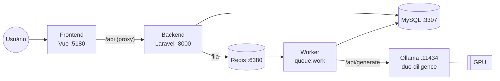

# Due Diligence de Fornecedores — PoC com IA local

Sistema para avaliar o **risco de contratar um fornecedor**: cadastra empresas e pessoas, o
quadro societário e os documentos (contrato social, certidões, consultas de sanção, notícias).
Uma **LLM local (Llama 3.2 3B)** lê os documentos e aponta os riscos com o trecho que os prova;
o sistema confere cada achado e calcula um **score explicado peso a peso**, com a recomendação
(aprovar, ressalvas, comitê ou reprovar).

<p align="center">
  
</p>

## Partes do sistema

| Pasta | O que é | Guia |
|---|---|---|
| [`backend/`](backend) | API REST **Laravel 12** (MySQL, fila no Redis, domínio de risco em PHP puro) + `compose.yaml` dos containers | [backend/README.md](backend/README.md) |
| [`frontend/`](frontend) | **Vue 3 + TypeScript** (Vite, Router, Pinia, PrimeVue, Tailwind, i18n) | [frontend/README.md](frontend/README.md) |
| [`ia/`](ia) | Modelo **due-diligence** do Ollama ([Modelfile](ia/Modelfile)) e pipeline de fine-tuning ([ia/treino](ia/treino)) | [docs/ia.md](docs/ia.md) |
| [`docs/`](docs) | Como a IA funciona: capacidade da máquina, treino, fluxos, diagramas | [docs/ia.md](docs/ia.md) |
| [`exemplos/`](exemplos) | Documentos **fictícios** da FM Soluções para testar a IA + script de avaliação | [ROTEIRO-LLM.md](exemplos/fm-solucoes/ROTEIRO-LLM.md) |



Cada caixa é um container (Laravel Sail), definido em [backend/compose.yaml](backend/compose.yaml).

## Subir tudo — um comando

Pré-requisitos: **Docker** com Compose v2 (no Windows, dentro do **WSL 2**, com o projeto em
`~/projetos`, não em `/mnt/c`) e o **NVIDIA Container Toolkit** para o Ollama usar a GPU.
Não é preciso ter PHP, Composer nem Node na máquina.

```bash
./subir.sh
```

O mesmo comando serve para a **1ª vez** e para o **dia a dia**: cada passo é pulado quando já está
feito, então ele nunca apaga o banco nem recria o modelo à toa.

| Passo | O que o `subir.sh` faz | Quando é pulado |
|---|---|---|
| 1 | Confere se o Docker está instalado e rodando | — |
| 2 | Instala as dependências PHP (`composer install`, local ou num container) | `backend/vendor` já existe |
| 3 | Cria o `backend/.env` a partir do `.env.example` | `.env` já existe |
| 4 | Sobe os 6 containers (`sail up -d`) | — (só inicia o que estiver parado) |
| 5 | Gera a `APP_KEY` | já existe |
| 6 | Cria/atualiza as tabelas (`migrate`) e popula o banco: importa o SQLite antigo, se houver, ou cria os dados de exemplo (`db:seed`) | banco já tem dados |
| 7 | Baixa o `llama3.2:3b` e cria o modelo `due-diligence` no Ollama | modelo já existe |
| 8 | Espera o frontend e a API responderem e mostra os endereços | — |

Outras opções:

```bash
./subir.sh status   # lista os containers e os endereços
./subir.sh parar    # para tudo (os dados ficam guardados nos volumes do Docker)
```

| Container | Função | Endereço no host |
|---|---|---|
| `web` | Frontend Vue (Vite) | http://localhost:5180 |
| `laravel.test` | API Laravel | http://localhost:8000 |
| `queue` | Worker da fila (análise por IA) | — |
| `mysql` | **Dados** (volume `sail-mysql`) | `localhost:3307` · banco `due_diligence` · usuário `sail` · senha `password` |
| `redis` | Fila dos jobs | `localhost:6380` |
| `ollama` | Llama 3.2 3B na GPU | http://localhost:11434 |

Todos têm `restart: unless-stopped`: quando o WSL/Docker reinicia, voltam sozinhos.

**Primeira vez:** demora alguns minutos (imagens Docker, `npm install` no container `web` e ~2 GB
do modelo de IA). Nas próximas, sobe em segundos.

Abra **http://localhost:5180**. Para ver a IA trabalhando: Terceiros → *FM Soluções Tecnologicas*
→ anexe os PDFs de [exemplos/fm-solucoes](exemplos/fm-solucoes) → **Analisar documentos com IA**.

Sem interface, pelo terminal: `cd backend && ./vendor/bin/sail artisan ia:analisar <id> --agora`.

### Comandos úteis (dentro de `backend/`)

```bash
./vendor/bin/sail ps                 # estado dos containers
./vendor/bin/sail logs -f queue      # acompanha o worker (análise por IA)
./vendor/bin/sail artisan <comando>  # qualquer comando artisan (migrate, tinker, ...)
./vendor/bin/sail mysql              # console do MySQL
./vendor/bin/sail down -v            # CUIDADO: para e APAGA os volumes (banco e fila)
```

**Se der erro de porta em uso** (8000, 5180, 3307, 6380 ou 11434): algum servidor local
(`php artisan serve`, `npm run dev`) ou container antigo está ocupando a porta. Pare-o, ou troque a
porta no `backend/.env` (`APP_PORT`, `WEB_PORT`, `FORWARD_DB_PORT`, `FORWARD_REDIS_PORT`,
`FORWARD_OLLAMA_PORT`) e rode `./subir.sh` de novo.

**Sem GPU NVIDIA:** remova o bloco `deploy:` do serviço `ollama` em `backend/compose.yaml`; o modelo
roda na CPU (mais lento).

## Destaques

- **A IA sugere, o código decide:** cada achado precisa citar um trecho que exista literalmente no
  documento; tipos inválidos, certidões negativas e anos sem evidência são descartados com o motivo.
- **Assíncrono:** a API responde 202 na hora; um job lê os documentos e dispara outro que grava o
  resultado; a tela acompanha o progresso a cada 2 s.
- **Explicável e auditável:** o score mostra cada peso (apontamentos, idade, PEP, sócios ×
  participação, teto); ficam gravados tempos, tokens, modelo e a resposta bruta da IA.
- **Medido:** o modelo especializado acerta 4 de 4 achados nos documentos de teste (o modelo
  sem preparo acertou 1); detalhes em [docs/ia.md](docs/ia.md).
- **Padrões:** respostas da API num formato único, mensagens em pt-BR/en, CPF/CNPJ validados
  pelos dígitos verificadores, frontend tipado em camadas.

## Testes

```bash
cd backend && ./vendor/bin/sail artisan test   # 68 testes (API, domínio, anexos, IA com Ollama simulado)
cd frontend && npm run build            # type-check + build (precisa de Node na máquina)
cd exemplos/fm-solucoes && php analisar-com-llama.php due-diligence   # avalia a IA real
```

## Treino de live coding

O domínio de risco nasceu como desafio de live coding. O esqueleto vazio está em
[backend/treino](backend/treino) e os 7 testes de aceitação rodam com
`./vendor/bin/sail artisan test --group=desafio`.
