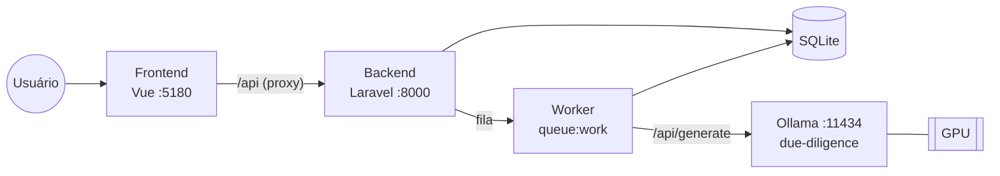

# Due Diligence de Fornecedores — PoC com IA local

Sistema para avaliar o **risco de contratar um fornecedor**: cadastra empresas e pessoas, o
quadro societário e os documentos (contrato social, certidões, consultas de sanção, notícias).
Uma **LLM local (Llama 3.2 3B)** lê os documentos e aponta os riscos com o trecho que os prova;
o sistema confere cada achado e calcula um **score explicado peso a peso**, com a recomendação
(aprovar, ressalvas, comitê ou reprovar).

<p align="center">
  
</p>

## Partes do sistema

| Pasta | O que é | Guia |
|---|---|---|
| [`backend/`](backend) | API REST **Laravel 12** (SQLite, fila de jobs, domínio de risco em PHP puro) | [backend/README.md](backend/README.md) |
| [`frontend/`](frontend) | **Vue 3 + TypeScript** (Vite, Router, Pinia, PrimeVue, Tailwind, i18n) | [frontend/README.md](frontend/README.md) |
| [`ia/`](ia) | Modelo **due-diligence** do Ollama ([Modelfile](ia/Modelfile)) e pipeline de fine-tuning ([ia/treino](ia/treino)) | [docs/ia.md](docs/ia.md) |
| [`docs/`](docs) | Como a IA funciona: capacidade da máquina, treino, fluxos, diagramas | [docs/ia.md](docs/ia.md) |
| [`exemplos/`](exemplos) | Documentos **fictícios** da FM Soluções para testar a IA + script de avaliação | [ROTEIRO-LLM.md](exemplos/fm-solucoes/ROTEIRO-LLM.md) |



## Subir tudo

Pré-requisitos: PHP 8.2+, Composer, Node 18+, Docker com o Ollama (modelo `llama3.2:3b` baixado).

```bash
# 0. IA — uma vez: cria o modelo especializado no Ollama
./ia/criar-modelo.sh
```

```bash
# 1. Backend — terminal 1 (http://localhost:8000)
cd backend
composer setup   # só na 1ª vez: dependências, .env, banco SQLite e dados de exemplo
composer dev
```

```bash
# 2. Worker da fila — terminal 2 (executa a análise por IA)
cd backend
composer worker
```

```bash
# 3. Frontend — terminal 3 (http://localhost:5180)
cd frontend
npm install      # só na 1ª vez
npm run dev -- --port 5180
```

Abra **http://localhost:5180**. Para ver a IA trabalhando: Terceiros → *FM Soluções Tecnologicas*
→ anexe os PDFs de [exemplos/fm-solucoes](exemplos/fm-solucoes) → **Analisar documentos com IA**.

Sem interface, pelo terminal: `cd backend && php artisan ia:analisar <id> --agora`.

## Destaques

- **A IA sugere, o código decide:** cada achado precisa citar um trecho que exista literalmente no
  documento; tipos inválidos, certidões negativas e anos sem evidência são descartados com o motivo.
- **Assíncrono:** a API responde 202 na hora; um job lê os documentos e dispara outro que grava o
  resultado; a tela acompanha o progresso a cada 2 s.
- **Explicável e auditável:** o score mostra cada peso (apontamentos, idade, PEP, sócios ×
  participação, teto); ficam gravados tempos, tokens, modelo e a resposta bruta da IA.
- **Medido:** o modelo especializado acerta 4 de 4 achados nos documentos de teste (o modelo
  sem preparo acertou 1); detalhes em [docs/ia.md](docs/ia.md).
- **Padrões:** respostas da API num formato único, mensagens em pt-BR/en, CPF/CNPJ validados
  pelos dígitos verificadores, frontend tipado em camadas.

## Testes

```bash
cd backend && php artisan test          # 68 testes (API, domínio, anexos, IA com Ollama simulado)
cd frontend && npm run build            # type-check + build
cd exemplos/fm-solucoes && php analisar-com-llama.php due-diligence   # avalia a IA real
```

## Treino de live coding

O domínio de risco nasceu como desafio de live coding. O esqueleto vazio está em
[backend/treino](backend/treino) e os 7 testes de aceitação rodam com `composer test:desafio`.
