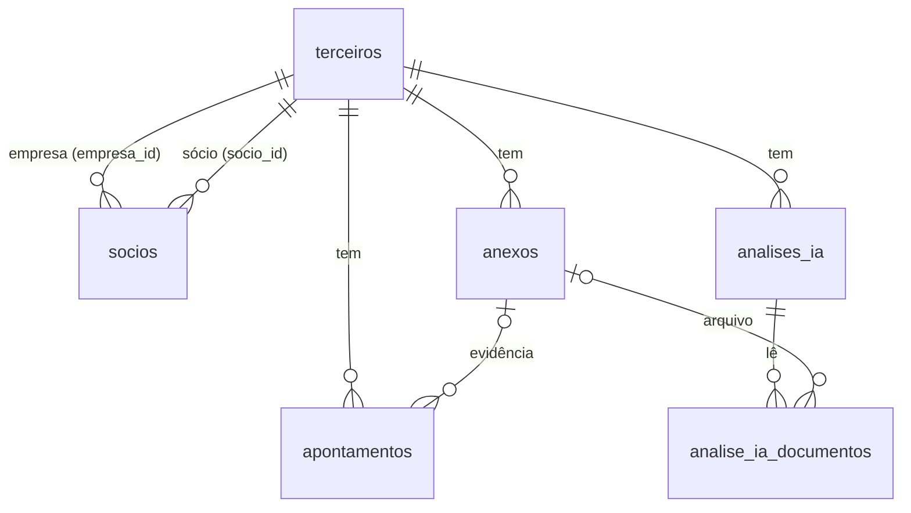
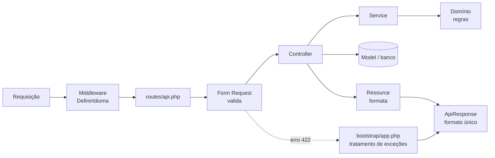
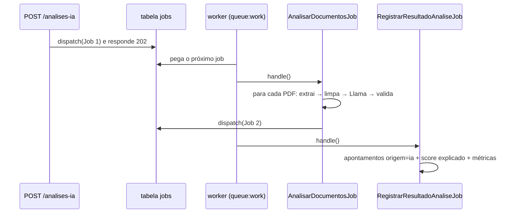

# Backend — API Laravel 12

API REST do sistema de due diligence: cadastro de terceiros (PF/PJ), apontamentos, quadro
societário, documentos anexados, cálculo de risco e **análise de documentos por IA** em fila.

| Item | Tecnologia |
|---|---|
| Linguagem | PHP 8.2+ (testado no 8.3) |
| Framework | Laravel 12 |
| Banco | SQLite (`database/database.sqlite`) |
| Fila | driver `database` (tabela `jobs`) |
| Arquivos | disco `local` → `storage/app/private` |
| IA | Ollama (Llama 3.2 3B) via HTTP — ver [docs/ia.md](../docs/ia.md) |
| Testes | PHPUnit (SQLite em memória) |

---

## 1. Como subir

### Pré-requisitos
- PHP 8.2+ com as extensões `pdo_sqlite`, `mbstring`, `fileinfo`
- Composer 2
- Para a análise por IA: Ollama rodando com o modelo `due-diligence` (`../ia/criar-modelo.sh`)

### Primeira vez
```bash
cd backend
composer setup
```
O `composer setup` faz, em ordem: `composer install` → copia `.env.example` para `.env` →
gera a `APP_KEY` → cria `database/database.sqlite` → `php artisan migrate:fresh --seed`
(cria as tabelas e os dados de exemplo).

### Dia a dia (2 terminais)
```bash
composer dev      # API em http://localhost:8000  (php artisan serve)
composer worker   # executa os jobs da fila — necessário para a análise por IA
```

| Comando | O que faz |
|---|---|
| `composer setup` | instala e prepara tudo do zero (apaga o banco!) |
| `composer dev` | sobe a API |
| `composer worker` | `php artisan queue:work --tries=1 --timeout=1900` |
| `composer test` | todos os testes |
| `composer test:api` | testes da API (sem os de aceitação do desafio) |
| `composer test:desafio` | 7 testes de aceitação do cálculo de risco |
| `composer desafio` | roda o `desafio.php` (script original do desafio) |

### Variáveis do `.env` mais importantes
| Variável | Padrão | Para quê |
|---|---|---|
| `APP_LOCALE` | `pt_BR` | idioma padrão das mensagens (o `Accept-Language` sobrescreve) |
| `DB_CONNECTION` | `sqlite` | banco |
| `QUEUE_CONNECTION` | `database` | fila dos jobs (`sync` executa na hora, sem worker) |
| `OLLAMA_URL` | `http://127.0.0.1:11434` | onde está o Ollama |
| `OLLAMA_MODEL` | `due-diligence` | modelo usado na análise |
| `OLLAMA_TIMEOUT` | `300` | segundos por documento |

---

## 2. Banco de dados e migrations

```bash
php artisan migrate                 # aplica as migrations pendentes
php artisan migrate:status          # mostra o que já rodou
php artisan migrate:rollback        # desfaz o último lote
php artisan migrate:fresh --seed    # APAGA tudo, recria e popula com os dados de exemplo
php artisan db:seed                 # só popula (database/seeders/DatabaseSeeder.php)
```

Criar uma migration nova:
```bash
php artisan make:migration create_contratos_table          # tabela nova
php artisan make:migration add_email_to_terceiros_table    # coluna nova numa tabela existente
php artisan make:model Contrato -m                         # model + migration juntos
```

| Migration | Tabelas |
|---|---|
| `0001_01_01_00000*` (padrão do Laravel) | `users`, `sessions`, `cache`, `jobs`, `failed_jobs` |
| `2026_11_18_000000_create_due_diligence_tables` | `terceiros`, `apontamentos`, `socios` |
| `2026_11_18_000001_create_anexos_table` | `anexos` |
| `2026_11_18_000002_create_analises_ia_tables` | `analises_ia`, `analise_ia_documentos` + colunas `origem`, `trecho`, `anexo_id`, `analise_ia_id` em `apontamentos` |



---

## 3. Estrutura e responsabilidade de cada classe

```
app/
├── Domain/DueDiligence/        ← REGRAS DE NEGÓCIO em PHP puro (não conhece Laravel)
│   ├── Terceiro.php            abstrata: nome, documento, apontamentos, explicarRisco()
│   ├── PessoaFisica.php        CPF válido, PEP (+20)
│   ├── PessoaJuridica.php      CNPJ válido, sócios × participação, detecção de ciclo
│   ├── Apontamento.php         tipo, ano, peso e depreciação (> 5 anos = metade)
│   ├── AnalisadorDeRisco.php   ranking e faixas de nível (BAIXO/MEDIO/ALTO/CRITICO)
│   └── Documento.php           validação de CPF/CNPJ (dígitos verificadores)
├── Models/                     ← Eloquent (tabelas)
│   ├── Terceiro, Apontamento, Socio, Anexo
│   └── AnaliseIa, AnaliseIaDocumento
├── Http/
│   ├── Controllers/Api/        ← recebem a requisição e devolvem ApiResponse
│   ├── Requests/               ← validação (TerceiroRequest, SocioRequest, AnexoRequest…)
│   ├── Resources/              ← formato do JSON de cada model
│   ├── Responses/              ← ApiResponse (formato único) e ErrorCode
│   └── Middleware/DefinirIdioma.php   ← Accept-Language → idioma das mensagens
├── Rules/                      ← regras de validação próprias (CpfValido, CnpjValido)
├── Services/
│   ├── MontadorDeTerceiros.php ← converte models do banco em objetos do domínio
│   ├── AvaliadorDeRisco.php    ← ponte API ↔ domínio (score, explicação)
│   └── Ia/                     ← análise por IA
│       ├── IniciadorDeAnalise.php   cria a análise e dispara o Job 1 (API e command)
│       ├── ExtratorDeTexto.php      PDF → texto, e limpeza (marca d'água, rodapé)
│       ├── ClienteLlm.php           HTTP com o Ollama
│       └── ValidadorDeAchados.php   travas do código sobre a resposta da IA
├── Jobs/
│   ├── AnalisarDocumentosJob.php        Job 1: lê documentos com a IA
│   └── RegistrarResultadoAnaliseJob.php Job 2: grava apontamentos e score
└── Console/Commands/
    └── AnalisarTerceiroCommand.php      php artisan ia:analisar {id}
```

### Como uma requisição percorre as camadas



- **Validação** fica no Form Request (`app/Http/Requests`), nunca no controller.
- **Regra de negócio** fica no domínio (`app/Domain`), que é PHP puro e testável sem banco.
- **Toda resposta** sai pelo `ApiResponse` com o mesmo formato:

```jsonc
{ "success": true,  "message": "Terceiro cadastrado com sucesso.", "data": { ... }, "meta": { ... } }
{ "success": false, "message": "Os dados informados são inválidos.", "code": "validation_error", "errors": { ... } }
```

| `code` | HTTP | Quando |
|---|---|---|
| `validation_error` | 422 | Form Request falhou |
| `business_rule` | 422 | regra de negócio (CPF inválido no domínio, ciclo societário, sem documentos…) |
| `not_found` | 404 | recurso não existe |
| `method_not_allowed` | 405 | método HTTP errado |
| `conflict` | 409 | já existe análise por IA em andamento |
| `domain_incomplete` | 501 | classes do domínio incompletas (modo treino) |
| `internal_error` | 500 | erro inesperado |

---

## 4. Endpoints

Todas as rotas ficam em [routes/api.php](routes/api.php) com o prefixo `/api`.
Para listar: `php artisan route:list --path=api`.

| Método | Rota | Controller | O que faz |
|---|---|---|---|
| GET | `/terceiros?busca=&tipo=pf\|pj` | TerceiroController@index | lista com filtros |
| POST | `/terceiros` | TerceiroController@store | cria (CPF/CNPJ validado pelos dígitos) |
| GET | `/terceiros/{id}` | TerceiroController@show | detalhe com apontamentos, sócios e anexos |
| PUT | `/terceiros/{id}` | TerceiroController@update | atualiza (o tipo não muda) |
| DELETE | `/terceiros/{id}` | TerceiroController@destroy | exclui (cascata + apaga arquivos) |
| POST | `/terceiros/{id}/apontamentos` | ApontamentoController@store | `tipo`, `ano` |
| DELETE | `/terceiros/{id}/apontamentos/{apontamento}` | ApontamentoController@destroy | |
| POST | `/terceiros/{id}/socios` | SocioController@store | `socio_id`, `participacao` (só PJ, soma ≤ 100%) |
| DELETE | `/terceiros/{id}/socios/{socio}` | SocioController@destroy | |
| GET | `/terceiros/{id}/anexos` | AnexoController@index | documentos anexados |
| POST | `/terceiros/{id}/anexos` | AnexoController@store | upload multipart: `categoria`, `arquivo` (PDF/JPG/PNG ≤ 2 MB) |
| GET | `/terceiros/{id}/anexos/{anexo}/download` | AnexoController@download | baixa o arquivo |
| DELETE | `/terceiros/{id}/anexos/{anexo}` | AnexoController@destroy | remove registro e arquivo |
| GET | `/terceiros/{id}/risco?ano=2026` | RiscoController@show | score e nível pelo domínio |
| GET | `/relatorio-risco?ano=2026` | RiscoController@relatorio | ranking de todos |
| POST | `/terceiros/{id}/analises-ia` | AnaliseIaController@store | **dispara a análise por IA → 202** |
| GET | `/terceiros/{id}/analises-ia` | AnaliseIaController@index | histórico de análises |
| GET | `/terceiros/{id}/analises-ia/{analise}` | AnaliseIaController@show | progresso, métricas, resultado e explicação |

Rotas aninhadas usam `scopeBindings()`: um `{apontamento}` de outro terceiro responde 404.

Exemplos com `curl`:
```bash
curl -s localhost:8000/api/terceiros -H 'Accept: application/json'
curl -s -X POST localhost:8000/api/terceiros -H 'Content-Type: application/json' \
     -d '{"tipo":"pf","nome":"Maria Teste","documento":"111.444.777-35"}'
curl -s -X POST localhost:8000/api/terceiros/5/anexos -F categoria=contrato_social -F arquivo=@contrato.pdf
curl -s -X POST localhost:8000/api/terceiros/5/analises-ia -H 'Content-Type: application/json' -d '{"ano":2026}'
curl -s -H 'Accept-Language: en' localhost:8000/api/terceiros/999   # mensagem em inglês
```

---

## 5. Filas e jobs

A análise por IA demora (segundos por documento), então roda **fora da requisição**:



| Job | Responsabilidade | Timeout |
|---|---|---|
| `AnalisarDocumentosJob` | lê cada documento com a IA, valida os achados, grava tempo e tokens por documento; documento ilegível vira "ignorado"; IA fora do ar marca a análise como "falhou"; no fim dispara o Job 2 | 1.800 s |
| `RegistrarResultadoAnaliseJob` | em transação, troca os apontamentos de origem "ia" pelos achados válidos (os manuais ficam), calcula o score explicado e grava nível, recomendação e métricas | padrão |

Comandos da fila:
```bash
php artisan queue:work --tries=1 --timeout=1900   # processa (o composer worker faz isso)
php artisan queue:listen                          # igual, mas recarrega o código a cada job (bom em dev)
php artisan queue:failed                          # lista jobs que falharam
php artisan queue:retry all                       # tenta de novo os que falharam
php artisan queue:flush                           # apaga os que falharam
php artisan queue:clear                           # esvazia a fila
```

> Depois de alterar o código de um job, **reinicie o worker** (`queue:work` mantém o código
> antigo em memória). Em teste, `QUEUE_CONNECTION=sync` (phpunit.xml) executa na hora.

---

## 6. Commands (Artisan)

| Comando | O que faz |
|---|---|
| `php artisan ia:analisar 5` | coloca a análise do terceiro 5 na fila |
| `php artisan ia:analisar 5 --agora` | executa na hora, sem worker, e imprime a tabela com o resultado |
| `php artisan ia:analisar 5 --ano=2025` | usa outro ano de referência |

Saída real de `php artisan ia:analisar 5 --ano=2026 --agora` (FM Soluções, 6 PDFs fictícios):
```
Analisando os documentos de FM Soluções Tecnologicas com o modelo due-diligence...
+---------------------------------------+-----------+---------+-------------------+-------------+
| Documento                             | Status    | Duração | Achados válidos   | Descartados |
+---------------------------------------+-----------+---------+-------------------+-------------+
| 01-contrato-social.pdf                | concluido | 40.3 s  | pep               | 0           |
| 02-certidao-negativa-debitos.pdf      | concluido | 2.1 s   | -                 | 0           |
| 03-certidao-negativa-trabalhista.pdf  | concluido | 1.8 s   | -                 | 0           |
| 04-certidao-distribuicao-criminal.pdf | concluido | 10.1 s  | processo_criminal | 0           |
| 05-consulta-cadastro-sancoes.pdf      | concluido | 8.5 s   | sancao            | 0           |
| 06-clipping-midia.pdf                 | concluido | 13.5 s  | midia_negativa    | 0           |
+---------------------------------------+-----------+---------+-------------------+-------------+

Score 100.0 · CRITICO · recomendação: reprovar · ACHADO ELIMINATÓRIO (em 77.3 s)
```
(o 1º documento inclui o tempo de carregar o modelo na GPU)

---

## 7. Como criar cada peça (geradores do Artisan)

| Para criar | Comando | Onde fica |
|---|---|---|
| Command de terminal | `php artisan make:command NomeDoCommand` | `app/Console/Commands` (registro automático) |
| Job de fila | `php artisan make:job NomeDoJob` | `app/Jobs` (implementa `ShouldQueue`) |
| Migration | `php artisan make:migration create_x_table` | `database/migrations` |
| Model (+ migration, factory, seeder, controller) | `php artisan make:model X -mfsc` | `app/Models` … |
| Controller de API | `php artisan make:controller Api/XController --api` | `app/Http/Controllers/Api` |
| Validação | `php artisan make:request XRequest` | `app/Http/Requests` |
| Formato do JSON | `php artisan make:resource XResource` | `app/Http/Resources` |
| Regra de validação | `php artisan make:rule NomeDaRegra` | `app/Rules` |
| Middleware | `php artisan make:middleware Nome` | `app/Http/Middleware` (registrar em `bootstrap/app.php`) |
| Seeder | `php artisan make:seeder XSeeder` | `database/seeders` |
| Teste | `php artisan make:test XTest` (ou `--unit`) | `tests/Feature` / `tests/Unit` |

**Exemplo — um job novo** (`php artisan make:job NotificarComiteJob`):
```php
class NotificarComiteJob implements ShouldQueue
{
    use Queueable;

    public function __construct(public int $analiseId) {}

    public function handle(): void
    {
        // o worker executa isto fora da requisição
    }
}

// para disparar:
NotificarComiteJob::dispatch($analise->id);              // vai para a fila
NotificarComiteJob::dispatch($analise->id)->delay(60);   // daqui a 60 s
```

**Exemplo — um command novo** (`php artisan make:command LimparAnalisesAntigas`):
```php
class LimparAnalisesAntigas extends Command
{
    protected $signature = 'ia:limpar {--dias=90}';
    protected $description = 'Apaga análises de IA mais antigas que N dias';

    public function handle(): int
    {
        $total = AnaliseIa::where('created_at', '<', now()->subDays((int) $this->option('dias')))->delete();
        $this->info("{$total} análise(s) apagada(s).");

        return self::SUCCESS;
    }
}
```

---

## 8. Como a lógica funciona de verdade

### Cálculo do risco (domínio)
1. O `MontadorDeTerceiros` lê o terceiro do banco e monta o objeto do domínio
   (`PessoaFisica` ou `PessoaJuridica`), com os apontamentos e, para PJ, os sócios
   (recursivamente; o mesmo sócio vira o mesmo objeto, e um ciclo A → B → A é detectado).
2. `explicarRisco(ano)` soma:
   - cada apontamento: sanção 40, processo criminal 30, mídia negativa 15, processo trabalhista 10
     (**metade** se tiver mais de 5 anos);
   - PF: **+20** se for PEP;
   - PJ: **+ score de cada sócio × participação**.
3. Arredonda e aplica o **teto de 100**; o `AnalisadorDeRisco` classifica:
   Baixo 0–24 · Médio 25–49 · Alto 50–74 · Crítico 75–100.
4. `calcularRisco()` usa o próprio `explicarRisco()` → o número e a explicação nunca divergem.

### Análise por IA
1. `POST /analises-ia` → `IniciadorDeAnalise`: recusa se já houver análise rodando (409) ou se
   não houver anexos (422); cria a análise e uma linha por documento; dispara o Job 1; **202**.
2. **Job 1** — para cada anexo: `ExtratorDeTexto` (PDF → texto, limpeza) → `ClienteLlm`
   (`POST /api/generate` no Ollama, JSON, temperatura 0) → `ValidadorDeAchados`:
   tipo válido, **trecho literal** no documento, não é certidão negativa, ano aparece no texto,
   sem repetição. Grava achados (com o motivo dos descartados), tokens e duração.
3. **Job 2** — numa transação, troca os apontamentos `origem = ia` pelos achados válidos que
   entram no score (sanção, processos, mídia); PEP e débito fiscal ficam como informativos.
   Calcula o score explicado; recomendação = **reprovar** se houver sanção eliminatória ou nível
   Crítico, **comitê** se Alto, **aprovar com ressalvas** se Médio, **aprovar** se Baixo.

Detalhes da IA (modelo, capacidade da GPU, como foi treinada): [docs/ia.md](../docs/ia.md).

---

## 9. Testes

```bash
php artisan test                       # 68 testes
php artisan test --filter=AnaliseIa    # só o fluxo da IA (Ollama simulado com Http::fake)
php artisan test --group=desafio       # aceitação do cálculo de risco
```

| Arquivo | Cobre |
|---|---|
| `Feature/TerceiroApiTest` | CRUD, filtros, CPF/CNPJ, formato padrão, idioma, 404/405 |
| `Feature/ApontamentoApiTest`, `SocioApiTest` | sub-recursos, soma ≤ 100%, escopo |
| `Feature/AnexoApiTest` | upload, download, exclusão de arquivos |
| `Feature/RiscoControllerTest` | controller de risco com mock |
| `Feature/DesafioRiscoTest` | domínio real: scores, ciclo, CPF |
| `Feature/AnaliseIaTest` | Job 1 → Job 2, travas, reanálise, IA fora do ar, OCR, 409, command |
| `Unit/DocumentoTest` | dígitos verificadores de CPF/CNPJ |
