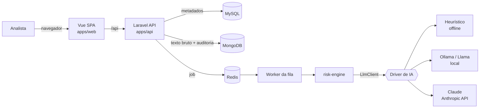
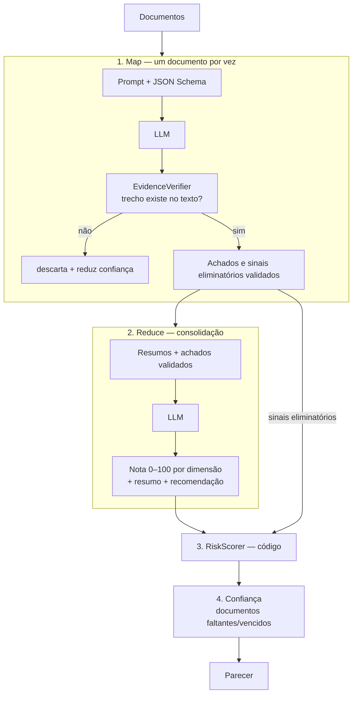
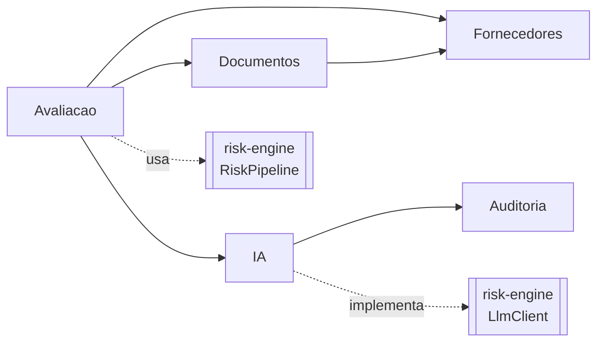
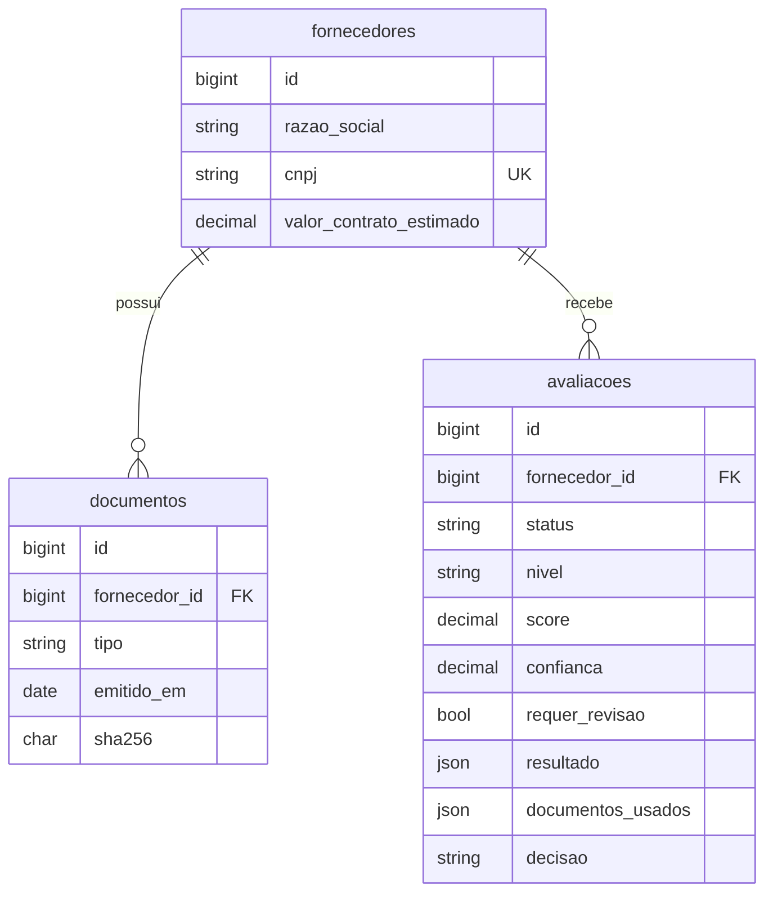

# Arquitetura

Este documento explica como a prova de conceito está organizada, como uma avaliação de risco
acontece de ponta a ponta e por que as principais decisões foram tomadas.

- [1. Visão geral](#1-visão-geral)
- [2. Estrutura do monorepo](#2-estrutura-do-monorepo)
- [3. Containers](#3-containers)
- [4. Motor de risco (`packages/risk-engine`)](#4-motor-de-risco-packagesrisk-engine)
- [5. API Laravel modular (`apps/api`)](#5-api-laravel-modular-appsapi)
- [6. Frontend (`apps/web`)](#6-frontend-appsweb)
- [7. Dados: o que fica em cada banco](#7-dados-o-que-fica-em-cada-banco)
- [8. Fluxo de uma avaliação](#8-fluxo-de-uma-avaliação)
- [9. Drivers de IA](#9-drivers-de-ia)
- [10. Segurança e governança](#10-segurança-e-governança)
- [11. Testes](#11-testes)
- [12. Decisões de arquitetura](#12-decisões-de-arquitetura)
- [13. Próximos passos para produção](#13-próximos-passos-para-produção)

---

## 1. Visão geral

O problema: antes de subcontratar uma construtora para uma obra de bilhões de reais, a empresa precisa
saber se o fornecedor tem risco **baixo, médio ou elevado** de dar calote, não entregar, usar trabalho
escravo ou não ser idôneo. A informação está espalhada em dezenas de documentos (certidões, balanços,
atestados, processos, notícias).

A solução separa responsabilidades:

| Quem | Faz o quê |
|---|---|
| **LLM** | Lê texto não estruturado, resume cada documento, extrai achados com evidência e dá uma nota de risco por dimensão |
| **Código (regras determinísticas)** | Confere as evidências, aplica regras eliminatórias, calcula o score e a classificação final, mede a confiança |
| **Humano (comitê)** | Toma a decisão final quando o risco é médio/elevado ou a confiança é baixa |

> O LLM **nunca** decide sozinho o nível de risco. Ele produz insumos; a classificação é uma fórmula
> aberta, auditável e configurável.



## 2. Estrutura do monorepo

```
avaliacao-risco-fornecedores/
├── RESPOSTA.md                  # resposta escrita da questão
├── README.md                    # como executar
├── docs/
│   ├── arquitetura.md           # este documento
│   ├── api.md                   # referência da API REST
│   └── operacao.md              # IA, GPU, testes, problemas comuns
├── scripts/
│   ├── testar-tudo.sh           # roda todas as suítes de teste
│   ├── avaliar-com-llama.sh     # avalia as construtoras de demo com o Llama
│   ├── configurar-claude.sh     # grava a chave da Anthropic sem exibi-la
│   └── habilitar-gpu-wsl.sh     # NVIDIA Container Toolkit + GPU no Ollama
├── packages/
│   └── risk-engine/             # motor de risco em PHP puro (sem framework)
└── apps/
    ├── api/                     # Laravel 13 + Sail
    │   ├── compose.yaml         # containers
    │   ├── compose.gpu.yaml     # override opcional de GPU
    │   └── modules/             # módulos de domínio
    └── web/                     # Vue 3 + Vite + TypeScript
```

O `apps/api` consome o `packages/risk-engine` como **path repository** do Composer, com symlink.
Uma mudança no motor vale imediatamente na API, sem publicar pacote.

## 3. Containers

Tudo roda com **Laravel Sail** (Docker Compose). Definição em [`apps/api/compose.yaml`](../apps/api/compose.yaml).

| Serviço | Imagem | Porta no host | Papel |
|---|---|---|---|
| `laravel.test` | `sail-8.4/app` (PHP 8.4) | `8080` | API REST |
| `queue` | `sail-8.4/app` | — | `php artisan queue:work redis` — processa as avaliações |
| `web` | `node:22-alpine` | `5173` | Vite servindo o Vue; repassa `/api` para `laravel.test` |
| `mysql` | `mysql:8.4` | `3307` | Dados relacionais |
| `redis` | `redis:alpine` | `6380` | Fila e cache |
| `mongodb` | `mongodb/mongodb-atlas-local` | `27018` | Texto dos documentos e auditoria do LLM |
| `ollama` | `ollama/ollama:0.6.8` | `11434` | LLM local (Llama), opcional |

As portas do host foram deslocadas (8080, 3307, 6380, 27018) para não conflitar com outros projetos.
Todas são configuráveis no `apps/api/.env`.

**Detalhe do monorepo no Docker:** dentro do container o app fica em `/var/www/html`, então o caminho
relativo `../../packages` aponta para `/var/packages`. Por isso `laravel.test` e `queue` montam
`../../packages:/var/packages`.

**GPU:** o arquivo [`compose.gpu.yaml`](../apps/api/compose.gpu.yaml) reserva a GPU NVIDIA para o
`ollama`. Ele só entra em uso se `COMPOSE_FILE=compose.yaml:compose.gpu.yaml` estiver no `.env`,
então quem não tem GPU sobe o projeto normalmente.

## 4. Motor de risco (`packages/risk-engine`)

PHP puro, sem dependência de framework nem de provedor de IA. É o coração da PoC e pode ser reutilizado
em qualquer aplicação (Laravel, Symfony, CLI, Lambda…).

```
src/
├── Contracts/LlmClient.php      # porta: json(system, prompt, schema): array
├── Prompts.php                  # prompts e JSON Schemas das duas etapas com LLM
├── RiskPipeline.php             # orquestrador
├── Pipeline/
│   ├── DocumentAnalyzer.php     # etapa map
│   ├── EvidenceVerifier.php     # confere evidência literal
│   └── DimensionAssessor.php    # etapa reduce
├── Scoring/
│   ├── ScoringPolicy.php        # pesos e limiares (configuráveis)
│   └── RiskScorer.php           # classificação determinística
├── Data/                        # DTOs imutáveis (Document, Finding, Assessment…)
├── Enums/                       # Dimension, Severity, RiskLevel, KnockOut, DocumentType
├── Support/HeuristicLlmClient.php   # "LLM" offline por palavras-chave (demo/testes)
└── Testing/FakeLlmClient.php        # dublê de teste com respostas programadas
```

### 4.1 Pipeline



### 4.2 Dimensões e pesos

| Dimensão | Peso | O que cobre |
|---|---|---|
| `financeira` | 30% | Risco de calote: balanço, recuperação judicial, protestos |
| `tecnica` | 25% | Capacidade de entrega: atestados, atrasos, obras abandonadas |
| `trabalhista` | 20% | CNDT, passivo trabalhista, acidentes, trabalho escravo |
| `juridica` | 15% | Certidões, CEIS/CNEP, execuções fiscais, improbidade |
| `reputacional` | 10% | Notícias, investigações, reclamações |

### 4.3 Regras de classificação

Definidas em [`RiskScorer`](../packages/risk-engine/src/Scoring/RiskScorer.php), com parâmetros em
[`modules/Avaliacao/config.php`](../apps/api/modules/Avaliacao/config.php):

1. `score = Σ nota_dimensão × peso`
2. `score < 35` → **BAIXO** · `35 ≤ score < 65` → **MÉDIO** · `score ≥ 65` → **ELEVADO**
3. Qualquer dimensão com nota **≥ 80** → no mínimo **MÉDIO**: uma dimensão crítica não é diluída pelas outras
4. Qualquer **sinal eliminatório** confirmado → **ELEVADO**

Sinais eliminatórios ([`KnockOut`](../packages/risk-engine/src/Enums/KnockOut.php)): Lista Suja do trabalho
escravo, empresa inidônea (CEIS/CNEP), falência, CNPJ inapto/baixado, condenação por corrupção.

### 4.4 Confiança e revisão humana

A confiança começa em 1,0 e cai por:

| Motivo | Penalidade |
|---|---|
| Documento obrigatório ausente | −0,08 cada |
| Documento vencido | −0,05 cada |
| Dimensão que o modelo não avaliou (recebe nota neutra 50) | −0,10 cada |
| Item descartado por evidência inexistente | −0,02 cada (máx. −0,20) |

**Revisão humana obrigatória** quando o risco é MÉDIO/ELEVADO **ou** a confiança fica abaixo de 0,7.

Documentos obrigatórios e validade ([`DocumentType`](../packages/risk-engine/src/Enums/DocumentType.php)):

| Documento | Obrigatório | Validade |
|---|---|---|
| Cartão CNPJ | sim | 30 dias |
| Certidão negativa federal | sim | 180 dias |
| CNDT (débitos trabalhistas) | sim | 180 dias |
| Lista Suja do trabalho escravo | sim | 30 dias |
| CEIS/CNEP | sim | 30 dias |
| Balanço / DRE | sim | 365 dias |
| Atestado de capacidade técnica | sim | — |
| Processos judiciais, notícias, outros | não | — |

### 4.5 Defesas contra erros do LLM

| Risco | Defesa |
|---|---|
| Alucinação | Cada achado exige trecho literal; [`EvidenceVerifier`](../packages/risk-engine/src/Pipeline/EvidenceVerifier.php) confere no texto original |
| Formato inválido | Saída com JSON Schema; valores fora dos enums são descartados |
| Prompt injection | Documento delimitado por `<documento>`; delimitadores injetados são removidos; o prompt manda ignorar instruções no conteúdo |
| IDs inventados na consolidação | Só IDs de achados existentes são aceitos |
| Dimensão esquecida | Recebe nota neutra 50 e reduz a confiança |
| Recusa / resposta truncada | O adaptador lança `LlmException`; a avaliação vai para `falhou` (análise manual) |

## 5. API Laravel modular (`apps/api`)

Cada módulo fica em `apps/api/modules/<Nome>` e segue a mesma estrutura:

```
modules/<Nome>/
├── Providers/<Nome>ServiceProvider.php   # registra bindings; herda ModuleServiceProvider
├── routes/api.php                        # carregado automaticamente com prefixo /api
├── Database/Migrations/                  # carregadas automaticamente
├── config.php                            # vira config('<nome>.*')
├── Http/ Models/ Services/ ...
└── Tests/{Unit,Integration}/
```

A classe base [`ModuleServiceProvider`](../apps/api/modules/Shared/Providers/ModuleServiceProvider.php)
descobre rotas, migrations e config pela pasta do módulo. Os providers ficam registrados em
[`bootstrap/providers.php`](../apps/api/bootstrap/providers.php).

| Módulo | Responsabilidade | Depende de |
|---|---|---|
| **Fornecedores** | Cadastro, validação de CNPJ | — |
| **Documentos** | Recebe documentos; metadados + SHA-256 no MySQL, texto no MongoDB | Fornecedores |
| **Auditoria** | Grava cada chamada ao LLM no MongoDB; expõe a consulta | — |
| **IA** | Escolhe o driver (`heuristico`, `ollama`, `anthropic`) e embrulha com auditoria | Auditoria |
| **Avaliacao** | Orquestra: fila, pipeline, persistência do parecer, decisão do comitê | Fornecedores, Documentos, IA |

Os módulos conversam por **serviços e contratos**, não acessando tabelas uns dos outros. Exemplos:
`DocumentoService::comConteudo()` e `AuditoriaLlm::registrar()`.



## 6. Frontend (`apps/web`)

Vue 3 + Vite + TypeScript, sem biblioteca de UI.

| Tela | Rota | O que faz |
|---|---|---|
| Fornecedores | `/` | Lista e cadastra fornecedores |
| Fornecedor | `/fornecedores/:id` | Documentos, aviso de obrigatórios faltantes, botão **Avaliar risco**, histórico |
| Avaliação | `/avaliacoes/:id` | Polling enquanto o job roda; parecer, notas por dimensão, eliminatórios, achados com evidência, decisão do comitê, auditoria do LLM |

O Vite faz proxy de `/api` para o Laravel. Por isso não há CORS: navegador e API parecem a mesma origem.

## 7. Dados: o que fica em cada banco



| Banco | Coleção/tabela | Conteúdo | Por quê |
|---|---|---|---|
| MySQL | `fornecedores`, `documentos`, `avaliacoes` | Dados relacionais, status, parecer (JSON) | Integridade referencial e consultas por status/nível |
| MongoDB | `documentos_conteudo` | Texto integral de cada documento + SHA-256 | Texto grande e sem esquema fixo |
| MongoDB | `auditoria_llm` | Prompt, resposta, modelo, duração, tokens e erro de cada chamada | Log volumoso, append-only, formato variável por driver |
| Redis | `queues:avaliacoes` | Jobs pendentes | Processamento assíncrono |

**Rastreabilidade:** cada avaliação grava em `documentos_usados` o `id`, o `tipo` e o `sha256` das versões
exatas dos documentos lidos. Com a auditoria do MongoDB, o parecer pode ser reproduzido e explicado.

## 8. Fluxo de uma avaliação

```mermaid
sequenceDiagram
    actor U as Analista
    participant W as Vue
    participant A as API
    participant R as Redis
    participant Q as Worker
    participant E as risk-engine
    participant L as LLM
    participant DB as MySQL / MongoDB

    U->>W: clica "Avaliar risco"
    W->>A: POST /api/fornecedores/{id}/avaliacoes
    A->>DB: cria avaliação (status=pendente)
    A->>R: enfileira ProcessarAvaliacaoJob
    A-->>W: 202 Accepted
    loop a cada 1,5 s
        W->>A: GET /api/avaliacoes/{id}
    end
    R->>Q: entrega o job
    Q->>DB: status=processando; lê documentos + texto
    Q->>E: RiskPipeline::run()
    loop cada documento
        E->>L: resumo + achados (JSON Schema)
        L-->>E: JSON
        E->>DB: auditoria da chamada
    end
    E->>L: consolidação por dimensão
    L-->>E: notas 0–100
    E-->>Q: Assessment (nível, score, confiança, motivos)
    Q->>DB: status=concluida + parecer
    W->>A: GET /api/avaliacoes/{id}
    A-->>W: parecer completo
    U->>W: comitê registra a decisão
    W->>A: POST /api/avaliacoes/{id}/decisao
```

Regras do fluxo:

- Só uma avaliação em andamento por fornecedor (a segunda chamada recebe **409**).
- Sem documentos, a avaliação é recusada (**422**).
- Se o LLM falhar, a avaliação vai para `falhou` com a mensagem de erro, sem parecer parcial.
- A decisão do comitê só é aceita em avaliações `concluida`.

## 9. Drivers de IA

O motor depende só da interface [`LlmClient`](../packages/risk-engine/src/Contracts/LlmClient.php).
O módulo IA escolhe a implementação pela variável `IA_DRIVER`.

| Driver | Classe | Custo | Qualidade | Uso indicado |
|---|---|---|---|---|
| `heuristico` (padrão) | [`HeuristicLlmClient`](../packages/risk-engine/src/Support/HeuristicLlmClient.php) | zero | Regras de palavra-chave, determinístico | Demo, desenvolvimento, testes de integração |
| `ollama` | [`OllamaLlmClient`](../apps/api/modules/IA/Clients/OllamaLlmClient.php) | zero (roda local) | Modelo pequeno (`llama3.2:3b`); bom para experimentar | Testar o pipeline com um LLM de verdade sem chave |
| `anthropic` | [`AnthropicLlmClient`](../apps/api/modules/IA/Clients/AnthropicLlmClient.php) | por token | Alta (`claude-opus-5-5`) | Uso real |

Todos os drivers:

- recebem o mesmo JSON Schema (Claude via `output_config.format`, Ollama via `format`);
- são embrulhados pelo [`AuditingLlmClient`](../apps/api/modules/IA/Clients/AuditingLlmClient.php), que grava
  cada chamada no MongoDB com o `avaliacao_id` (propagado pelo `Context` do Laravel).

O adaptador do Claude também usa cache do prompt de sistema (que se repete em todos os documentos) e
trata `stop_reason` de recusa e de truncamento como erro.

## 10. Segurança e governança

| Tema | Na PoC | Em produção |
|---|---|---|
| Autenticação | Não há | SSO corporativo; perfis analista × comitê |
| Segredos | `.env` fora do git; `configurar-claude.sh` grava a chave sem exibi-la | Cofre de segredos |
| Dados pessoais (LGPD) | Seed com empresas fictícias | Base legal, retenção, mascaramento de CPF de sócios |
| Humano no loop | Decisão do comitê registrada com responsável e justificativa | Fluxo de aprovação com alçadas |
| Auditoria | Toda chamada ao LLM no MongoDB; SHA-256 dos documentos | Retenção imutável (WORM) |

## 11. Testes

| Suíte | Local | Tipo | Depende de |
|---|---|---|---|
| Motor | `packages/risk-engine/tests` | Unitário | nada (LLM falso) |
| Módulos | `apps/api/modules/*/Tests/Unit` | Unitário | nada (HTTP fake, auditoria em memória) |
| Integração | `apps/api/modules/*/Tests/Integration`, `apps/api/tests/Integration` | HTTP + bancos reais | MySQL, Redis, MongoDB do Sail |
| Frontend | `apps/web/src/__tests__` | Unitário (Vitest + jsdom) | nada |

Os testes de integração usam o banco `testing` (MySQL e MongoDB), separado do banco de desenvolvimento.
Eles cobrem: cadastro e validação, gravação em MySQL+MongoDB, o fluxo completo das três construtoras de
demo (baixo/médio/elevado), auditoria, fila, duplicidade (409), ausência de documentos (422) e decisão do
comitê. Como rodar: [README](../README.md#testes).

## 12. Decisões de arquitetura

| Decisão | Alternativa considerada | Motivo |
|---|---|---|
| LLM dá notas; código classifica | Pedir "baixo/médio/alto" direto ao LLM | Explicável, consistente, auditável e ajustável sem mexer em prompt |
| Map-reduce por documento | Um prompt com todos os documentos | Cabe no contexto, rastreável por documento, paralelizável |
| Evidência literal verificada em código | Confiar na resposta | Principal defesa contra alucinação |
| Motor em pacote PHP puro | Lógica dentro do Laravel | Testável sem framework, reutilizável, troca de provedor sem tocar no domínio |
| Módulos próprios | `nwidart/laravel-modules` | Sem dependência externa; estrutura explícita |
| SPA separada (Vue) | Inertia | Front e back independentes; a API serve outros clientes |
| MongoDB para texto e auditoria | Tudo no MySQL | Documentos grandes e logs com formato variável |
| Avaliação em fila (Redis) | Requisição síncrona | Dezenas de chamadas ao LLM levam minutos |
| Driver heurístico | Exigir chave de API para rodar | Demo e testes de integração sem custo e determinísticos |

## 13. Próximos passos para produção

1. **Evals:** conjunto de empresas já classificadas por analistas para medir acurácia (especialmente o
   recall de casos ELEVADOS) a cada mudança de prompt ou modelo.
2. **Ingestão:** extração de PDF/OCR e integração com fontes oficiais (Receita, TST, MTE, CGU, tribunais).
3. **Escala:** analisar documentos em paralelo (jobs em lote) e usar a Batch API para reavaliações.
4. **Monitoramento contínuo:** reavaliar periodicamente durante a obra e alertar quando surgir um sinal novo.
5. **Autenticação, perfis e trilha de aprovação** com alçadas.
