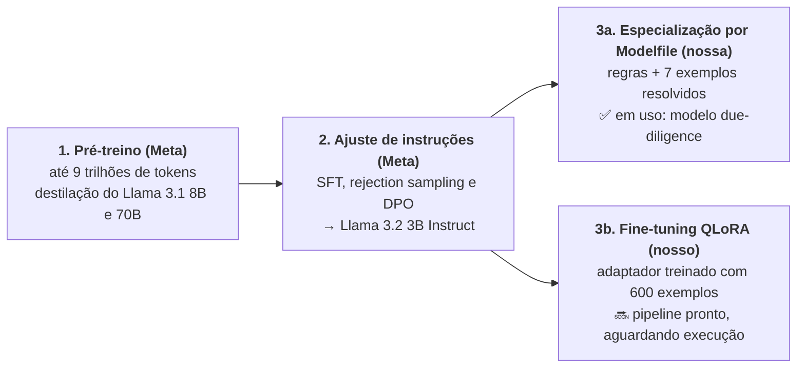
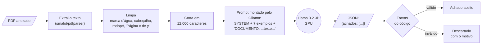
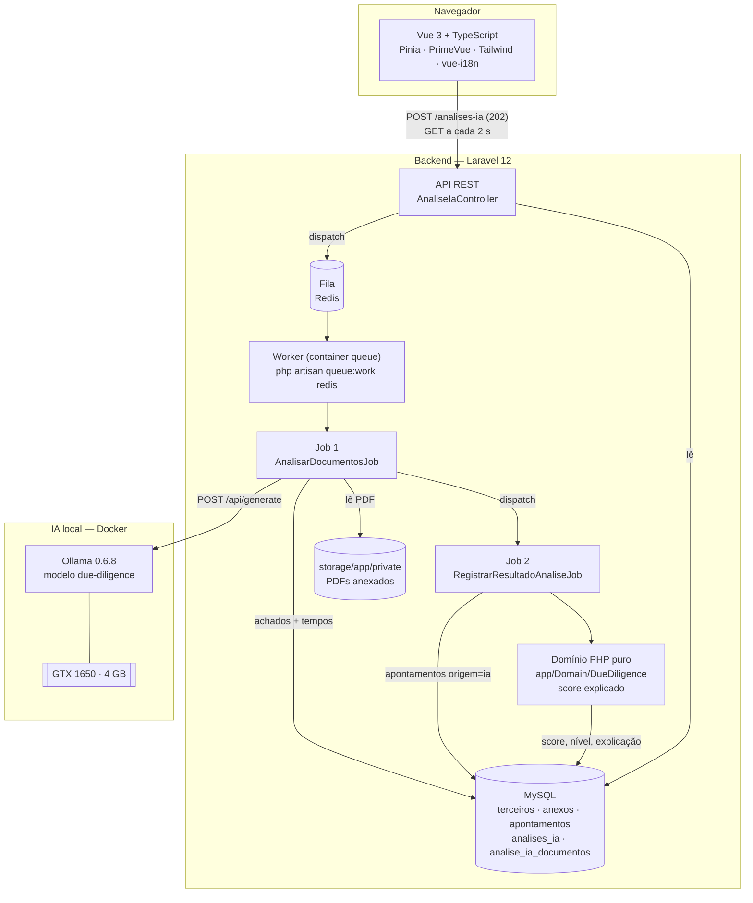
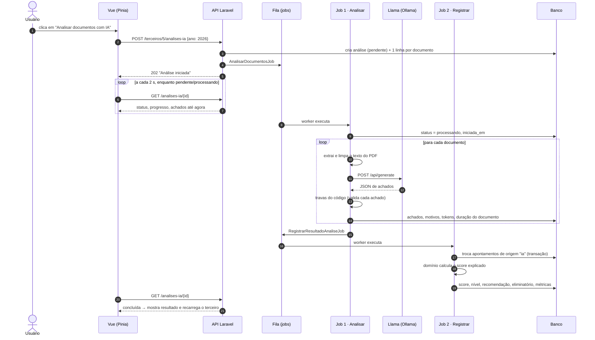
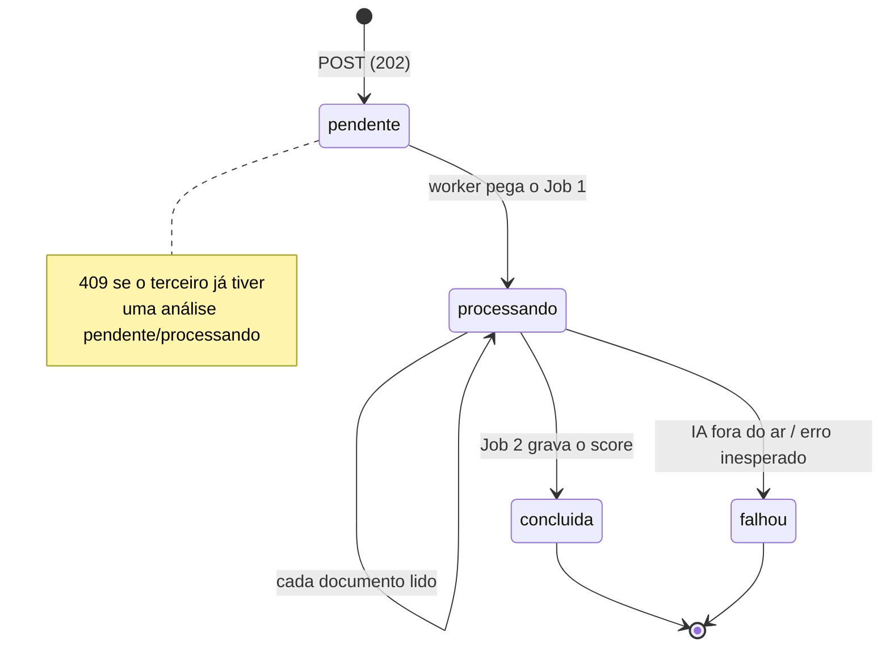
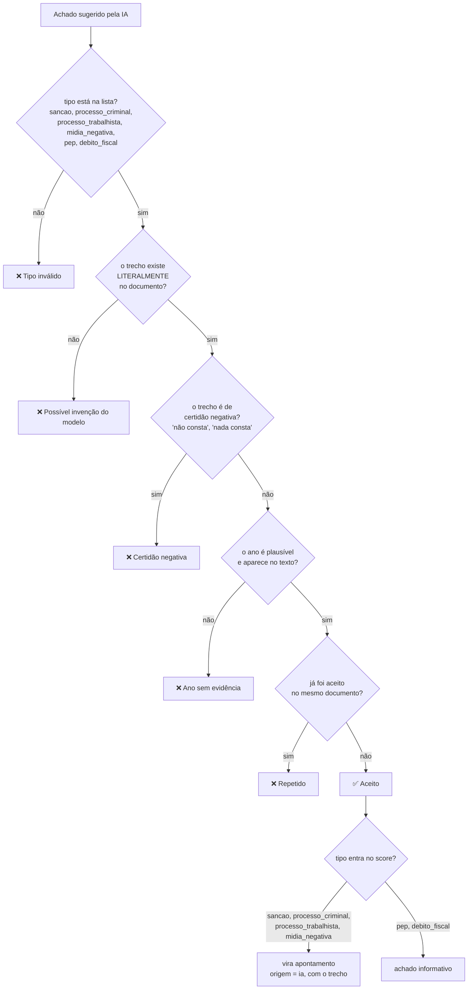
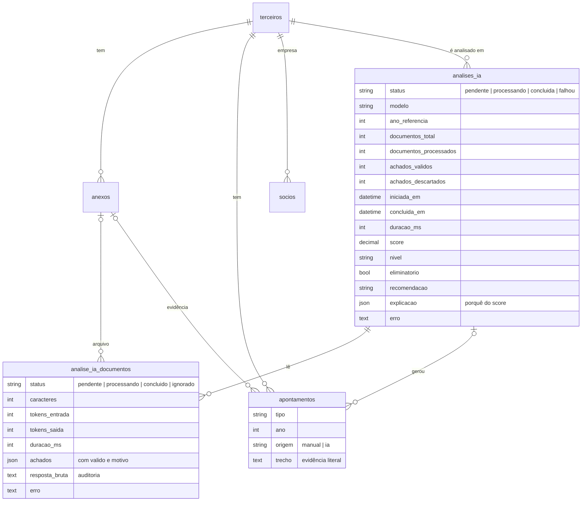

# Análise de documentos por IA — como funciona

Esta prova de conceito usa uma **LLM local** (Llama 3.2 3B rodando no Ollama, na GPU da máquina)
para **ler os documentos de um fornecedor** — contrato social, certidões, consultas de sanção,
notícias — e apontar riscos. O **sistema** confere cada coisa que a IA disser e calcula o score
com regras fixas e explicáveis.

> **Princípio da PoC: a IA sugere, o código decide.** O modelo só extrai achados com o trecho
> que os prova; quem aceita, pondera e classifica é o código.

<p align="center">
  
</p>

**Sumário:** [A LLM](#1-a-llm) · [Quanto a máquina aguenta](#2-quanto-a-máquina-aguenta) ·
[Como ela foi treinada](#3-como-ela-foi-treinada) · [Uma chamada à IA](#4-o-que-acontece-numa-chamada-à-ia) ·
[Arquitetura](#5-arquitetura) · [Fluxo assíncrono](#6-fluxo-assíncrono-jobs) ·
[Travas](#7-travas-do-código) · [Score](#8-como-o-score-é-calculado) · [Dados](#9-modelo-de-dados) ·
[Métricas](#10-métricas-registradas) · [Operação](#11-como-rodar-e-operar) · [Limitações](#12-limitações-e-próximos-passos)

---

## 1. A LLM

| Item | Valor |
|---|---|
| Modelo | **Llama 3.2 3B Instruct** (Meta), versão conversacional |
| Parâmetros | **3.212.749.888** (≈ 3,2 bilhões) |
| Arquitetura | Transformer decoder: 28 camadas, dimensão 3.072, 24 cabeças de atenção (8 de chave/valor — *GQA*), vocabulário de 128.256 tokens |
| Contexto máximo do modelo | 131.072 tokens (128k) — **usamos 8.192** |
| Formato / quantização | GGUF **Q4_K_M** (pesos em ~4 bits) → arquivo de **2,02 GB** (em 16 bits seriam ~6,4 GB) |
| Servidor | **Ollama 0.6.8** em container Docker (serviço `ollama` do [compose.yaml](../backend/compose.yaml)), API HTTP em `127.0.0.1:11434` (na rede interna: `http://ollama:11434`) |
| Modelo usado pela PoC | **`due-diligence`** = `llama3.2:3b` + instruções + exemplos ([ia/Modelfile](../ia/Modelfile)) |
| Idiomas | 8 oficiais, incluindo **português** |
| Licença | Llama 3.2 Community License |

**Por que um modelo de 3B?** É o maior da família Llama 3.2 que cabe na GPU desta máquina
(veja a seção 2), roda localmente (os documentos não saem do computador) e é gratuito.

## 2. Quanto a máquina aguenta

### Hardware

| Recurso | Valor |
|---|---|
| GPU | **NVIDIA GeForce GTX 1650 — 4 GB de VRAM** (compute capability 7.5, sem bf16) |
| CPU | AMD Ryzen 7 3750H (8 threads) |
| RAM do WSL | 6,7 GB (metade dos 13,9 GB do Windows; ajustável no `.wslconfig`) |

### O que ocupa a memória da GPU

A memória de uma LLM é **pesos + cache de atenção (KV cache) + buffers de cálculo**:

```
pesos (Q4_K_M)       ≈ 2,0 GB                     (fixo)
KV cache por token   = 2 (K e V) × 28 camadas × 8 cabeças KV × 128 dims × 2 bytes ≈ 112 KB
KV cache, 8.192 tok  ≈ 0,9 GB        |  KV cache, 4.096 tok ≈ 0,45 GB
buffers de cálculo   ≈ 1 GB
```

**Medido nesta máquina** (`ollama ps` com o `due-diligence` carregado e contexto de 8.192):
**4,13 GB no total, 3,41 GB na GPU** → ~0,7 GB ficam na CPU. Funciona, mas parte do cálculo
roda mais devagar. Com **contexto de 4.096** (os documentos da PoC usam ~2.000 a 2.600 tokens)
o modelo cabe **inteiro na GPU**.

### Até quantos parâmetros

| Tamanho do modelo (Q4_K_M) | Exemplo | Arquivo | Nesta GPU de 4 GB |
|---|---|---|---|
| 1B | `llama3.2:1b` | ~1,3 GB | ✅ inteiro na GPU, com folga (mais rápido, menos preciso) |
| **3B – 4B** | **`llama3.2:3b`**, `qwen2.5:3b`, `phi3.5` | ~2,0 – 2,2 GB | ✅ **limite prático** — inteiro na GPU com contexto até ~4k |
| 7B – 8B | `llama3.1:8b`, `qwen2.5:7b` | ~4,7 – 4,9 GB | ⚠️ roda com metade das camadas na CPU: **3 a 6× mais lento** e apertado na RAM do WSL |
| 13B ou mais | — | 7+ GB | ❌ inviável nesta máquina |

**Para treinar** (fine-tuning QLoRA, seção 3.3) a conta é outra: o modelo em 4 bits + gradientes
do adaptador + ativações. Na GTX 1650 isso dá **~3,5 GB para o 3B** (no limite, com o Ollama
desligado) e **~2 GB para o 1B** (confortável).

## 3. Como ela foi treinada

São **três camadas** — só a primeira mexe em todos os pesos do modelo:



### 3.1 Pré-treino e ajuste de instruções (feitos pela Meta)

Segundo o *model card* da Meta, os Llama 3.2 1B e 3B foram pré-treinados com **até 9 trilhões de
tokens** de dados públicos, usando os modelos maiores (Llama 3.1 8B e 70B) como "professores"
(*destilação de conhecimento*). Depois passaram por ajuste de instruções (SFT, *rejection sampling*
e DPO) para seguir comandos. O conhecimento vai até **dezembro de 2023**. É daí que vêm a leitura
de português e a capacidade de seguir instruções — **nada disso é específico de due diligence**.

### 3.2 Especialização pelo Modelfile (em uso)

O [ia/Modelfile](../ia/Modelfile) cria o modelo `due-diligence` **sem alterar os pesos**. Ele
fixa três coisas que vão junto em toda chamada:

| Peça | O que é | Para quê |
|---|---|---|
| `SYSTEM` | ~1.800 caracteres de instruções | formato JSON, os 6 tipos de achado, regras (certidão negativa → nada; não juntar tipos; ignorar rodapé…) |
| `MESSAGE` | **7 exemplos resolvidos** (14 mensagens): certidão negativa, certidão criminal positiva, sanção eliminatória, documento misto, contrato com PEP, notícias, débito trabalhista | o modelo aprende o padrão pelos exemplos (*few-shot*) |
| `PARAMETER` | `temperature 0`, `num_ctx 8192`, `top_p 0.9` | respostas determinísticas e espaço para o documento |

Os exemplos usam **empresas diferentes** das do teste, para medir se o modelo aprendeu a regra
(e não o gabarito). Resultado nos 6 documentos fictícios da FM Soluções
([exemplos/fm-solucoes](../exemplos/fm-solucoes)):

| Modelo | Achados certos | Precisão | Cobertura | Nível final |
|---|---|---|---|---|
| `llama3.2:3b` sem preparo | 1 de 4 | 100% | 25% | BAIXO ❌ |
| **`due-diligence`** | **4 de 4** | **100%** | **100%** | **ELEVADO ✅** |

Durante a avaliação apareceu um problema que **não era do modelo**: o aviso "DOCUMENTO FICTÍCIO —
SEM VALOR LEGAL" no topo fazia a IA concluir que não havia nada a analisar. A correção ficou no
código (limpeza do texto antes de enviar — seção 4).

### 3.3 Fine-tuning QLoRA (pipeline pronto)

Para treinar de verdade os pesos (com a GPU de 4 GB), a pasta [ia/treino](../ia/treino) tem:

| Arquivo | O que faz |
|---|---|
| `gerar_dataset.py` | gera **600 documentos sintéticos** com gabarito (540 treino / 60 validação), metade sem achados e com frases "pegadinha" |
| `instalar.sh` | cria o ambiente Python com PyTorch (CUDA) e Unsloth |
| `treinar.py` | **QLoRA**: modelo base congelado em 4 bits, treina só um adaptador LoRA (rank 16) — fp16, lote 1 × acumulação 8, sequência 1.536 |
| `criar-modelo-ft.sh` | cria `due-diligence-ft` no Ollama: `llama3.2:3b` + `ADAPTER` treinado |

A perda é calculada **só na resposta** (o JSON), não no documento de entrada. Depois do treino,
o mesmo script de avaliação compara `due-diligence-ft` com o `due-diligence`.

## 4. O que acontece numa chamada à IA



- **Requisição:** `POST /api/generate` com `format: "json"` (o Ollama força JSON válido),
  `temperature: 0` e `num_ctx: 8192` — ver [ClienteLlm.php](../backend/app/Services/Ia/ClienteLlm.php).
- **Tamanho medido:** ~2.000 a 2.600 tokens de entrada por documento (≈ 1.800 são as instruções e
  exemplos) e 7 a 126 tokens de saída.
- **Formato da resposta:**

```json
{"achados": [{"tipo": "sancao", "ano": 2026, "envolvido": "FM Soluções Tecnologicas",
  "trecho": "Tipo de sanção: Impedimento de licitar e contratar com a Administração Pública",
  "eliminatorio": true}]}
```

## 5. Arquitetura



## 6. Fluxo assíncrono (jobs)

A análise demora (≈ 5 a 15 s por documento na GPU), então **nada roda dentro da requisição HTTP**:
a API responde **202** na hora e a tela acompanha o progresso.



### Estados da análise



Um documento que não dá para ler (imagem sem OCR, PDF escaneado) fica como **ignorado** e não
derruba a análise. Se o Ollama não responder, a análise fica como **falhou** com o motivo.

## 7. Travas do código

Toda resposta do modelo passa pelo [ValidadorDeAchados](../backend/app/Services/Ia/ValidadorDeAchados.php).
Um achado só é aceito se passar por **todas**:



Além disso: **só sanção pode ser eliminatória**, mesmo que o modelo marque outro tipo.

## 8. Como o score é calculado

O cálculo é do **domínio** ([app/Domain/DueDiligence](../backend/app/Domain/DueDiligence)), em PHP
puro, e é o mesmo para apontamentos manuais e vindos da IA. O método `explicarRisco()` devolve
cada parcela — é ele que alimenta o "**Por que esse score?**" da tela.

| Regra | Valor |
|---|---|
| Sanção | 40 |
| Processo criminal | 30 |
| Mídia negativa | 15 |
| Processo trabalhista | 10 |
| Apontamento com **mais de 5 anos** | vale **metade** |
| Pessoa física **PEP** | **+20** |
| Pessoa jurídica | risco próprio **+ Σ (score do sócio × participação)** (recursivo, com detecção de ciclo) |
| Teto | **100** |
| Nível | Baixo 0–24 · Médio 25–49 · Alto 50–74 · Crítico 75–100 |
| Recomendação | **reprovar** se houver achado eliminatório ou nível Crítico · comitê se Alto · aprovar com ressalvas se Médio · aprovar se Baixo |

**Exemplo real — FM Soluções Tecnologicas (2026):**

| Parcela | Conta | Entra |
|---|---|---|
| Processo criminal 2026 (achado pela IA) | 30, 0 anos | +30 |
| Sanção 2026 (achado pela IA, **eliminatório**) | 40, 0 anos | +40 |
| Mídia negativa 2025 (achado pela IA) | 15, 1 ano | +15 |
| Holding XPTO | 45 × 20% | +9 |
| Felipe Moraes Teste (PEP + mídia 2025) | 35 × 50% | +17,5 |
| Mariana Teixeira Teste | 0 × 30% | +0 |
| **Soma** | | 111,5 → **teto 100 · Crítico · Reprovar** |

## 9. Modelo de dados



## 10. Métricas registradas

| Métrica | Onde |
|---|---|
| Duração total da análise e espera na fila | `analises_ia.duracao_ms`, `metricas.espera_ms` |
| Duração, caracteres e tokens (entrada/saída) por documento | `analise_ia_documentos` |
| Achados válidos e descartados (com o motivo de cada descarte) | `analises_ia`, `analise_ia_documentos.achados` |
| Modelo usado | `analises_ia.modelo` |
| Resposta bruta do modelo | `analise_ia_documentos.resposta_bruta` (auditoria) |
| Score explicado peso a peso | `analises_ia.explicacao` |

**Medição real** (FM Soluções, 6 PDFs, modelo já carregado na GPU):

| Documento | Duração | Tokens entrada → saída | Achados |
|---|---|---|---|
| Contrato social | 11,9 s | 2.611 → 75 | PEP (informativo) |
| Certidão negativa de débitos | 2,1 s | 2.061 → 7 | — |
| Certidão negativa trabalhista | 1,8 s | 2.018 → 7 | — |
| Certidão criminal | 9,2 s | 2.281 → 73 | processo criminal |
| Consulta de sanções | 9,3 s | 2.166 → 63 | sanção (eliminatória) |
| Clipping de mídia | 15,3 s | 2.184 → 126 | mídia negativa |
| **Total** | **≈ 51 s** | | 4 válidos, 0 descartados |

Na primeira análise depois de ligar o Ollama, some ~45 s para carregar o modelo na GPU.
O tempo cresce com os **tokens de saída**: certidão negativa (resposta `[]`) leva ~2 s.

## 11. Como rodar e operar

```bash
./subir.sh                           # sobe tudo: API, worker, Vue, MySQL, Redis e Ollama
                                     # (e cria o modelo due-diligence se ainda não existir)
cd backend && ./vendor/bin/sail logs -f queue   # acompanha a análise no worker
./ia/criar-modelo.sh                 # recria o modelo depois de editar o ia/Modelfile
```

| Variável (`backend/.env`) | Padrão | Para quê |
|---|---|---|
| `OLLAMA_URL` | `http://ollama:11434` | onde está o Ollama (nome do container) |
| `OLLAMA_MODEL` | `due-diligence` | trocar por `due-diligence-ft` depois do fine-tuning |
| `OLLAMA_TIMEOUT` | `300` | segundos por documento |
| `IA_MAX_CARACTERES` | `12000` | corte do texto enviado |

**Avaliar um modelo** contra o gabarito:
```bash
cd exemplos/fm-solucoes && php analisar-com-llama.php due-diligence
```

**Testes** (Ollama simulado com `Http::fake`): `cd backend && ./vendor/bin/sail artisan test --filter=AnaliseIa`.

## 12. Limitações e próximos passos

| Limitação | Próximo passo |
|---|---|
| Avaliação com só 6 documentos (4 achados) | rodar também nos 60 exemplos de validação do dataset e em documentos reais anonimizados |
| A IA atribui à empresa fatos de um sócio (ex.: a notícia sobre o Felipe), e o fato pode contar duas vezes | usar o campo `envolvido` para ligar o achado ao sócio certo |
| PDF escaneado / imagem não é lido | OCR (ex.: Tesseract) antes da extração |
| Contexto de 8k tira ~0,7 GB da GPU | usar `num_ctx 4096` (os documentos da PoC cabem) para ficar 100% na GPU |
| Pesos ainda não ajustados | executar o fine-tuning QLoRA (seção 3.3) e comparar |
| 3B erra mais que modelos grandes | com GPU maior: 7B/8B (ex.: `qwen2.5:7b`) ou modelo em nuvem, mantendo as travas do código |
| Score com pesos fixos | calibrar pesos e faixas com o comitê |
