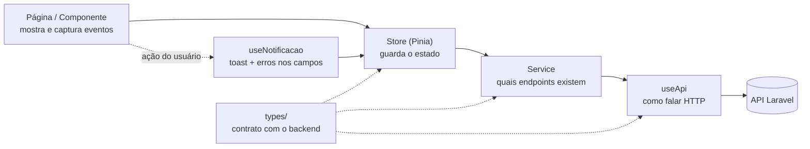
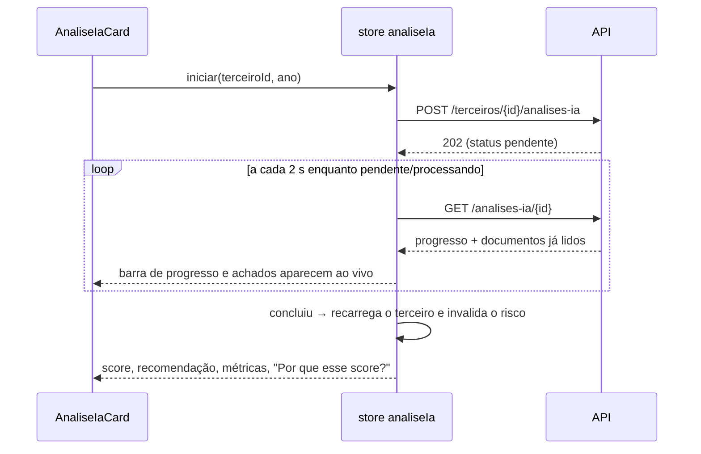

# Frontend — Vue 3 + TypeScript

Interface do sistema de due diligence: relatório de risco, cadastro de terceiros, quadro
societário, documentos anexados e a **análise por IA** com progresso ao vivo.

| Item | Tecnologia |
|---|---|
| Framework | Vue 3 (Composition API, `<script setup lang="ts">`) |
| Linguagem | TypeScript (checado com `vue-tsc`) |
| Build / dev server | Vite 5 (compatível com Node 18) |
| Rotas | Vue Router 4 |
| Estado | Pinia |
| Componentes | PrimeVue 4 (tema Aura) + PrimeIcons |
| Estilo | Tailwind CSS 3 (+ `tailwindcss-primeui` para as cores do tema) |
| Idiomas | vue-i18n (pt-BR e en) |

---

## 1. Como subir

### Pré-requisitos
- Node 18+ e npm
- O backend rodando em `http://127.0.0.1:8000` (ver [../backend/README.md](../backend/README.md))

```bash
cd frontend
npm install                     # 1ª vez
npm run dev -- --port 5180      # http://localhost:5180
```

| Comando | O que faz |
|---|---|
| `npm run dev` | servidor de desenvolvimento com recarga automática |
| `npm run type-check` | checa os tipos (TypeScript + arquivos `.vue`) |
| `npm run build` | type-check + build de produção em `dist/` |
| `npm run preview` | serve o `dist/` para conferir o build |

**Não há CORS:** o Vite repassa tudo que começa com `/api` para o Laravel
(proxy em [vite.config.ts](vite.config.ts)). Para apontar para outro backend, crie um `.env` com
`VITE_API_URL=https://outro-servidor/api`.

---

## 2. Estrutura

```
src/
├── main.ts                 cria o app: Pinia, Router, i18n, PrimeVue, Toast, Confirm
├── App.vue                 só <RouterView/> + Toast + ConfirmDialog (e textos do PrimeVue por idioma)
├── layouts/
│   └── DefaultLayout.vue   header + menu + <RouterView/> das páginas + rodapé
├── router/index.ts         rotas filhas do DefaultLayout (meta: título, menu, ícone)
├── pages/                  uma por rota
│   ├── RelatorioPage.vue        /               ranking de risco
│   ├── TerceirosPage.vue        /terceiros      lista, filtros, cadastro
│   └── TerceiroDetalhePage.vue  /terceiros/:id  detalhe e análise por IA
├── components/
│   ├── layout/   AppHeader, AppNav (menu gerado pelas rotas), LanguageSwitcher, AppFooter
│   ├── ui/       PageHeader, SectionCard, ApiErrorMessage, CampoErro
│   ├── terceiros/ TerceiroDialog, ApontamentosCard, SociosCard, AnexosCard
│   ├── risco/    RiscoCard, ResumoNiveis, NivelTag
│   └── analise/  AnaliseIaCard, ExplicacaoScore, DocumentoAnalisadoItem
├── stores/      (Pinia)  app (idioma), terceiros, risco, analiseIa
├── services/             terceirosService, riscoService, analiseIaService
├── composables/          useApi (HTTP), useNotificacao (mensagens)
├── types/                api, terceiro, risco, analise, router.d.ts
├── i18n/                 index.ts + locales/pt-BR.json e en.json
└── utils/                formatar (documento, bytes, data, duração), documento (CPF/CNPJ)
```

---

## 3. Camadas — cada uma com uma responsabilidade



| Camada | Sabe | Não sabe |
|---|---|---|
| **Componente** | o que mostrar e quando chamar a store | URLs, formato HTTP |
| **Store (Pinia)** | o estado (lista, terceiro aberto, análise em andamento) e como atualizá-lo | como montar a requisição |
| **Service** | quais endpoints existem e o tipo de cada retorno | estado, tela |
| **useApi** | URL base, headers, idioma (`Accept-Language`), JSON/FormData, formato padrão de erro | quais endpoints existem |
| **types/** | o contrato com o backend (espelha os Resources e o `ApiResponse`) | — |

### O padrão de mensagens

Toda resposta do backend tem o mesmo formato (`success`, `message`, `data` / `code`, `errors`).
O `useApi` transforma qualquer falha num `ApiError` (`status`, `code`, `message`, `errors`, `detail`).

- **Ação do usuário** (salvar, excluir, adicionar, analisar) →
  `notificacao.executar(() => store.acao(), { erros })`:
  sucesso mostra um toast com a `message` do backend; erro mostra o toast e preenche os
  `<CampoErro>` de cada campo com o `errors` da API.
- **Carregamento de tela** (lista, detalhe, risco, relatório) → o erro fica na store e aparece no
  lugar do conteúdo com `<ApiErrorMessage>` (cor decidida pelo `code`).
- **Idioma:** o idioma escolhido vai no header `Accept-Language`; o backend responde as mensagens
  (inclusive de validação) no mesmo idioma.

---

## 4. Como a análise por IA aparece na tela



- Se a página for reaberta durante a análise, a store retoma o acompanhamento
  (`carregarUltima`); ao sair da página o acompanhamento para (`parar`).
- `ExplicacaoScore` desenha o detalhamento vindo do backend: peso de cada apontamento,
  depreciação por idade, adicional de PEP, sócios × participação, soma e teto.
- `DocumentoAnalisadoItem` mostra, por documento, o tempo gasto e cada achado com o **trecho de
  evidência** — ou o motivo pelo qual o sistema o descartou.

---

## 5. Como adicionar uma página nova

1. Crie `src/pages/ContratosPage.vue`.
2. Registre em [src/router/index.ts](src/router/index.ts), dentro de `children` do `DefaultLayout`:
   ```ts
   {
     path: 'contratos',
     name: 'contratos',
     component: () => import('@/pages/ContratosPage.vue'),
     meta: { titulo: 'nav.contratos', menu: true, icone: 'pi pi-file', ordem: 3 },
   }
   ```
   Com `meta.menu: true` ela já aparece no menu.
3. Adicione `nav.contratos` em `i18n/locales/pt-BR.json` e `en.json`.
4. Se precisar de dados: tipo em `types/`, endpoints em `services/`, estado em `stores/`.
5. `npm run type-check`.
